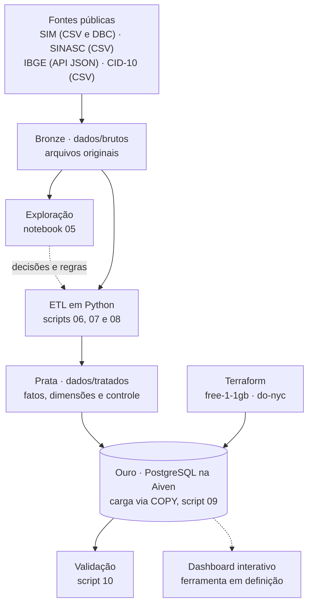

# Painel Epidemiológico de Mortalidade Materna e Violência Obstétrica

Pipeline de dados que trata os microdados públicos do SIM e do SINASC (2022 a 2024), valida os resultados contra fontes oficiais e armazena a base em um PostgreSQL na nuvem (Aiven, plano gratuito), provisionado com Terraform.

**Disciplina:** Big Data e Analytics · **ODS:** 5 (Igualdade de Gênero) e 18 (Igualdade Étnico-Racial)
**Equipe:** Alison Andrade Rocha, Lívia Alves de Souza e Vitor Carvalho Ferreira

## Situação do projeto

| Etapa | Situação |
| --- | --- |
| 1. Negócio e LGPD | Concluída (fase 1) |
| 2. Ingestão e tipagem | Concluída (fase 1) |
| 3. ETL e tratamento | Concluída (fase 2) |
| 4. Modelagem e banco | Concluída (fase 2) |
| 5. Regras de negócio | Em andamento |
| 6. Dashboard | Próxima fase |

## Arquitetura



## Estrutura do repositório

```
├── dados/
│   ├── brutos/          # arquivos originais (fora do Git, ver "Como reproduzir")
│   └── tratados/        # tabelas geradas pelo ETL
├── docs/                # relatório técnico da fase 2 (relatorio_fase2.docx)
├── etl/
│   ├── fase1/           # testes das APIs e extração dos municípios do IBGE
│   ├── fase2/           # notebook de exploração e scripts 06 a 10
│   └── sql/             # schema do banco (01_schema.sql)
├── terraform/           # main.tf, variables.tf, outputs.tf
└── dashboard/           # próxima fase
```

## Fontes de dados

| Base | Anos | Origem | Formato | Tipo de dado |
| --- | --- | --- | --- | --- |
| SIM – óbitos | 2022, 2023 | DATASUS – Transferência de Arquivos (`DOBR2022.dbc`, `DOBR2023.dbc`) | DBC | Estruturado |
| SIM – óbitos | 2024 | OpenDataSUS | CSV | Estruturado |
| SINASC – nascidos vivos | 2022 a 2024 | OpenDataSUS | CSV | Estruturado |
| Municípios | atual | API de Localidades do IBGE | JSON | Semiestruturado |
| CID-10 | 2008 | DATASUS | CSV | Estruturado |
| Dicionários de dados | — | Ministério da Saúde | PDF | Não estruturado |

Os CSVs do SIM de 2022 e 2023 no OpenDataSUS não têm linha de cabeçalho; por isso esses anos foram obtidos em DBC, que traz os nomes oficiais das colunas.

## Os 5 V's aplicados

- **Volume:** cerca de 7,5 milhões de nascimentos e 4,5 milhões de óbitos brutos (mais de 3 GB em CSV), reduzidos a 145 MB no banco por filtro (só óbitos maternos) e agregação (SINASC em contagens), sem amostragem.
- **Variedade:** dados estruturados (CSV e DBC), semiestruturados (JSON do IBGE) e não estruturados (dicionários em PDF).
- **Velocidade:** processamento em lote anual, com leitura em blocos para arquivos de mais de 500 MB.
- **Veracidade:** códigos validados contra a CID-10 oficial, ignorados padronizados, integridade referencial no banco e totais conferidos com o Painel de Monitoramento do Ministério da Saúde e o TabNet.
- **Valor:** indicadores de mortalidade materna e de intervenção obstétrica por raça/cor, idade, escolaridade e território.

## Principais regras de tratamento

- **Óbito materno:** óbito feminino com causa básica no capítulo XV da CID-10 (O00 a O99). Os tardios (O96, O97) e os associados a causas externas (marcador brasileiro O93) são mantidos, mas ficam fora da Razão de Mortalidade Materna (RMM), conforme a definição oficial.
- **Ignorados:** vazio, nulo e código 9 unificados como "Ignorado".
- **Raça/cor:** no SINASC é usada a `RACACORMAE` (da mãe), e não a `RACACOR` (do recém-nascido).
- **LGPD:** só as colunas da análise são lidas; datas de nascimento, estabelecimento de saúde, ocupação e naturalidade são descartadas.
- **SINASC agregado:** armazenado só como contagens, em duas tabelas (por município e por UF com variáveis do parto).

As decisões completas e suas justificativas estão no relatório técnico da fase 2 (`docs/relatorio_fase2.docx`), e a exploração que embasou cada uma, com os resultados, no notebook `etl/fase2/05_exploracao_bases.ipynb`.

## Modelo de dados

Modelo estrela com 3 tabelas fato e 14 dimensões. As fatos compartilham as dimensões de local, faixa etária, raça/cor e escolaridade, o que permite calcular a RMM em qualquer combinação desses recortes.

| Tabela | Linhas | Tamanho |
| --- | --- | --- |
| fato_nascidos_municipio | 711.592 | 70 MB |
| fato_nascidos_parto | 553.327 | 65 MB |
| fato_obito_materno | 4.914 | 992 kB |
| 14 dimensões | 5.590 municípios, 269 causas e tabelas de códigos | menos de 1 MB |
| **Total do banco** | | **145 MB (14% de 1 GB)** |

O schema completo, com tipos e chaves, está em `etl/sql/01_schema.sql`.

## Validação

| Ano | Óbitos (projeto) | Óbitos (Painel MS) | Nascidos vivos (projeto) | Nascidos vivos (TabNet) | RMM |
| --- | --- | --- | --- | --- | --- |
| 2022 | 1.370 | 1.368 | 2.561.922 | 2.561.922 | 53,5 |
| 2023 | 1.324 | 1.319 | 2.537.576 | 2.537.576 | 52,2 |
| 2024 | 1.326 | 1.326 | 2.389.325 | 2.389.325 | 55,5 |

Em 2024, os óbitos coincidem também nas 27 UFs. As pequenas diferenças de 2022 e 2023 vêm da versão da base: o painel é atualizado continuamente após as investigações de óbito. Consultas em 03/10/2026.

## Como reproduzir

**Pré-requisitos:** Python 3.12 ou superior, Terraform, conta na Aiven e, no Windows, o Microsoft C++ Build Tools (exigido pelo `pyreaddbc`).

```bash
pip install pandas requests dbfread pyreaddbc "psycopg[binary]"
```

1. **Baixar os dados brutos** em `dados/brutos/`, com estes nomes:
   - `sinasc_2022.csv`, `sinasc_2023.csv`, `sinasc_2024.csv` e `sim_2024.csv` (OpenDataSUS);
   - `DOBR2022.dbc` e `DOBR2023.dbc` (DATASUS – Transferência de Arquivos, SIM, Declarações de Óbito, UF BR);
   - tabelas da CID-10 do DATASUS em `dados/brutos/cid10/`.
2. **Gerar a tabela de municípios:** `python etl/fase1/04_extracao_municipios_ibge.py`
3. **Converter os DBC:** executar o notebook `etl/fase2/05_exploracao_bases.ipynb` até a seção de conversão.
4. **Tratar os dados:**
   ```bash
   python etl/fase2/06_tratamento_sim.py
   python etl/fase2/07_tratamento_sinasc.py
   python etl/fase2/08_dimensoes.py
   ```
5. **Provisionar o banco:** copiar `terraform/terraform.tfvars.example` para `terraform/terraform.tfvars`, preencher o token da Aiven e executar:
   ```bash
   cd terraform
   terraform init
   terraform apply
   ```
6. **Criar o `.env`** na raiz com a conexão (PowerShell, dentro de `terraform/`):
   ```powershell
   "DATABASE_URL=$(terraform output -raw uri_conexao)" | Out-File -Encoding ascii ..\.env
   ```
7. **Carregar e validar:**
   ```bash
   python etl/fase2/09_carga_postgres.py
   python etl/fase2/10_validacao_carga.py
   ```

## Segurança

Nenhuma credencial é versionada. O token da Aiven fica em `terraform/terraform.tfvars` e a URI do banco no `.env`, ambos listados no `.gitignore`, assim como o estado do Terraform (`*.tfstate`), que contém a senha do banco. Os outputs do Terraform com senha são marcados como sensíveis.

O banco está na região `do-nyc` (Nova York) porque o plano gratuito da Aiven só existe nas nuvens DigitalOcean e UpCloud, sem regiões na América do Sul. Os dados armazenados são públicos, anonimizados na origem e agregados no ETL, sem dados pessoais.
